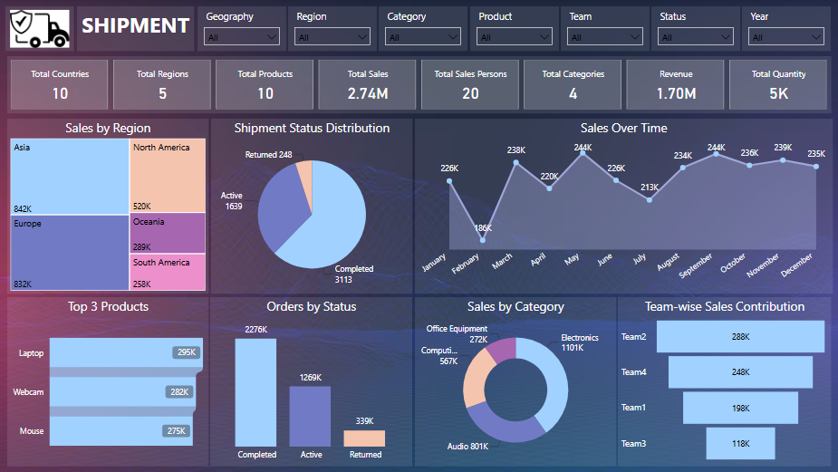

# Shipment

### Power BI Project
This project analyzes shipment and sales data to understand regional performance, product distribution, and order fulfillment trends. A Power BI dashboard was developed to visualize sales performance, shipment status, and product-wise contributions across different regions and categories. The dashboard helps stakeholders monitor shipment operations, evaluate sales trends, and make data-driven business decisions.

### Tools Covered : Advanced Excel, Power BI, Power Query, DAX

### Key Performance Indicators (KPIs):

• Total Countries

• Total Regions

• Total Products

• Total Sales

• Total Salespersons

• Total Categories

• Revenue

• Total Quantity

• Sales by Region

• Shipment Status

• Distribution

• Sales Over Time

• Top 3 Products

• Orders by Status

• Sales by Category

• TY Sales Contribution

### Dashboard Visualizations:

• Cards

• Treemap

• Pie Chart

• Line Chart

• Stacked Bar Chart

• Stacked Column Chart

• Donut Chart

• Funnel Chart

### Interactive Features:

• Slicers

### Dashboard Preview:

